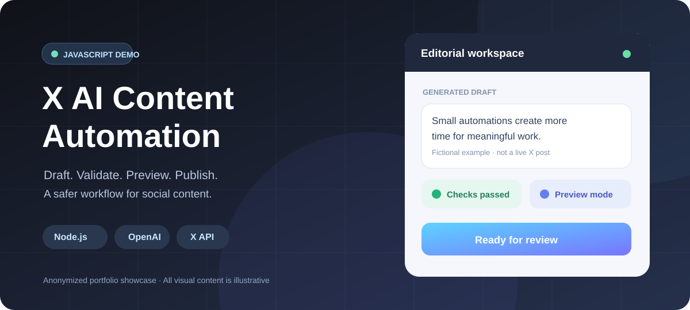
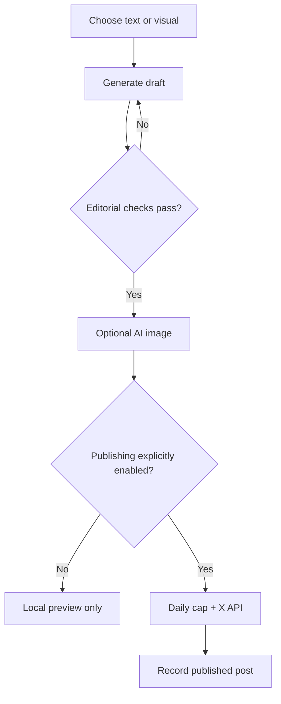

# X AI Content Automation



<p align="center"><strong>From a content idea to a reviewed post — with automation and explicit publishing control.</strong></p>

## Overview

**X AI Content Automation** is an independent JavaScript/Node.js portfolio project demonstrating how a content workflow for X can be automated. The system generates short educational posts, checks basic editorial rules, avoids exact duplicates, optionally generates an original visual, and can publish through the X API when explicitly authorized.

This demonstration was inspired by real-world automation work performed for a company, but it was **rewritten from scratch**. It contains no original client prompts, brand identity, production content history, contacts, credentials, or deployment configuration.

## Why it is useful

For small businesses, creators, and community teams, social media consistency often requires repetitive work. An automated workflow can help:

- **Save preparation time:** draft useful posts from a configurable range of technology topics.
- **Create a repeatable process:** separate generation, editorial validation, history checking, and publication.
- **Reduce accidental repetition:** check generated text against previous published posts.
- **Support visual content:** optionally generate an original illustration to accompany a post.
- **Control operational risk:** preview output by default; require two explicit settings before anything is published.

The system is a technical demonstration, not an autonomous editorial replacement: a human should still review accuracy, tone, usage rights, and platform policies before enabling live publication.

## Workflow



## Features

| Component | Role |
| --- | --- |
| OpenAI text generation | Drafts short posts about broadly useful technology topics |
| Editorial validation | Checks length, duplicate text, and a small list of risky claims |
| Image generation | Optional original image through the OpenAI Images API |
| Publication gateway | Explicit opt-in before posting via X API v2 |
| Local history | Records successful published posts in ignored `data/history.json` |
| Daily safety limit | Caps posts per UTC day when using the CLI |

## Quick start

Requires Node.js 20+, API credentials for optional AI generation, and X developer credentials only for live publication.

```bash
git clone https://github.com/natsouzax/x-ai-content-automation.git
cd x-ai-content-automation
npm install
cp .env.example .env
npm run preview
```

Without an OpenAI key, text previews use generic local demonstration content. Visual generation requires an OpenAI key and may incur API charges.
Generated visual previews are saved locally to `data/preview.png` and are not uploaded anywhere in preview mode.

### Commands

```bash
npm run preview           # Text preview; does NOT publish
npm run visual            # Visual preview; does NOT publish
npm test                  # Unit tests
node src/index.js text --publish    # Live publishing (only when enabled below)
```

To publish, set `ENABLE_LIVE_POSTING=true` with valid `X_API_KEY`, `X_API_SECRET`, `X_ACCESS_TOKEN`, and `X_ACCESS_SECRET`, **and** use `--publish`. Both controls are required. Visual publishing also supports `node src/index.js visual --publish`. Configure an external scheduler (such as cron) if timed execution is desired; no scheduler is bundled.

`MAX_POSTS_PER_DAY` defaults to 2. The limit is checked against the local history file, so it is not a distributed or tamper-resistant quota. Never run concurrent publishing processes without adding locking. Use a dedicated test X account first.

## Limitations and security

- The editorial check is a **basic demonstration**, not legal, financial, or platform-policy compliance certification.
- Generated claims require human review; no automated fact checking is implemented.
- `.env`, runtime history, and installed dependencies are ignored by Git.
- No production data or secrets are included. Never commit API keys or account-specific content.
- This repository is not affiliated with, or endorsed by, any former client.

## Author

Developed by [Natan Oliveira](https://github.com/natsouzax) · [Portfolio](https://natsouzax.vercel.app)
